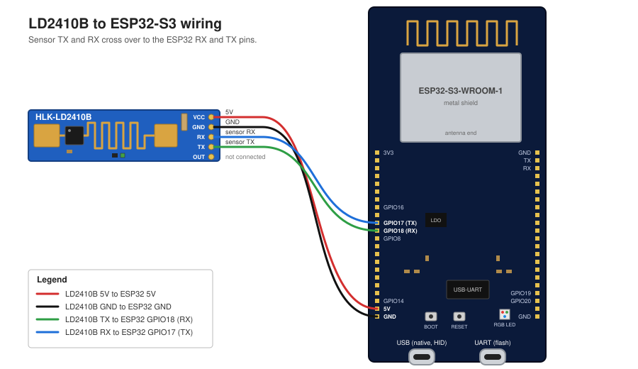

# LD2410 mouse emulator

## What it does

An ESP32-S3 and an LD2410B presence radar act as a USB HID mouse.

While someone is present, the pointer moves 1 px right and 1 px back every 30 s (`JIGGLE_MS`). This keeps the screensaver and the idle lock from starting.

Nothing moves when the room is empty. If no valid radar frame arrives for 5 s (`TIMEOUT_MS`), the sketch treats the room as empty.

Target host: an Ubuntu laptop. The board is flashed from a macOS machine.

## Hardware

### LD2410B radar

- HLK-LD2410B by Hi-Link.
- 24 GHz FMCW mmWave radar.
- Detects moving and stationary people. Static presence works through micro-motion such as breathing.
- Range: up to about 6 m for moving targets, about 4-5 m for static targets.
- Gate resolution: 0.75 m, 9 gates.
- Supply: 5 V (5-12 V accepted).
- UART: 3.3 V logic, 256000 baud, 8N1 by default.
- Also has an OUT pin (digital presence). This project does not use it.
- Bluetooth is built in. Use the HLKRadarTool phone app to tune it.
- Long, narrow blue board with a 5-pad header on one short edge.

### ESP32-S3 dev board

- DevKitC-1 style board with two USB-C ports.
- Dual-core Xtensa LX7, up to 240 MHz.
- Wi-Fi and BLE 5.
- 3.3 V GPIO.
- Native USB-OTG on GPIO19/20. This port becomes the HID mouse.
- The second USB-C port goes to a USB-UART bridge. It is used for flashing and the console.

| Port | Use | Plugged into |
|---|---|---|
| USB (native, HID) | Acts as the mouse | Ubuntu laptop (normal use) |
| UART (flash) | Flashing and serial console | macOS machine (when flashing) |

## Wiring



| LD2410B | ESP32-S3 |
|---|---|
| VCC (5-12 V) | 5V pin |
| GND | GND |
| UART Rx | GPIO17 (ESP32 TX) |
| UART Tx | GPIO18 (ESP32 RX, `Serial1`) |
| OUT | not connected |

- TX and RX cross over. Sensor TX goes to the ESP32 RX pin. Sensor RX goes to the ESP32 TX pin.
- Pad order taken from the vendor datasheet (section 4.2): VCC, GND, UART Rx, UART Tx, OUT, top to bottom with the antenna on the left.

## How it is implemented

The sketch is `ld2410-mouse-emulator.ino`. It uses `USB.h` and `USBHIDMouse.h` from Arduino-ESP32 (TinyUSB). It needs no external library.

`loop()` works in this order:

1. `Serial1` reads bytes from the radar.
2. A small state machine matches the frame header `F4 F3 F2 F1`.
3. It reads a 2-byte little-endian length.
4. It reads the data and the footer `F8 F7 F6 F5`.
5. It accepts data frames of type `0x02` (basic) or `0x01` (engineering) with marker `0xAA`.
6. The target-state byte decides presence: 0 none, 1 moving, 2 static, 3 both. Anything other than 0 means present.
7. Each accepted frame records `lastFrame`.
8. If `TIMEOUT_MS` passes with no accepted frame, the state becomes absent.
9. If present and `JIGGLE_MS` has elapsed, it calls `Mouse.move(1, 0)`, waits `delay(20)`, then calls `Mouse.move(-1, 0)`.

`lastMove` is reset on every pass while absent. The first nudge therefore comes 30 s after someone appears.

| Constant | Default | Meaning | Tuning |
|---|---|---|---|
| `JIGGLE_MS` | 30000 | Interval between nudges while present | Lower it if your idle timeout is under 30 s. |
| `TIMEOUT_MS` | 5000 | No valid frame for this long means absent | Raise it if the state flickers. Lower it to react faster. |

## Build and flash

Host: macOS, `arduino-cli`, esp32 core 3.3.x installed.

Compile:

```
arduino-cli compile -b esp32:esp32:esp32s3:USBMode=default,CDCOnBoot=cdc .
```

`USBMode=default` selects USB-OTG (TinyUSB). HID needs it.

Find the port with `arduino-cli board list`. Plug the cable into the UART USB-C port. Then upload:

```
arduino-cli upload -b esp32:esp32:esp32s3:USBMode=default,CDCOnBoot=cdc -p <PORT> .
```

Then move the cable to the native USB port. Plug it into the Ubuntu machine.

If the upload fails: hold BOOT, tap RESET, release BOOT. Then retry.

Ubuntu note: flashing from Linux needs `sudo usermod -aG dialout $USER`. Log out and in again afterwards.

## Limitations

- On some Wayland compositors a 1 px move may not reset the idle timer. If so, raise the move to 2 px.
- No configuration over UART. The radar runs with its default settings.
- Not tested on hardware yet. It compiles clean (28% of flash).
